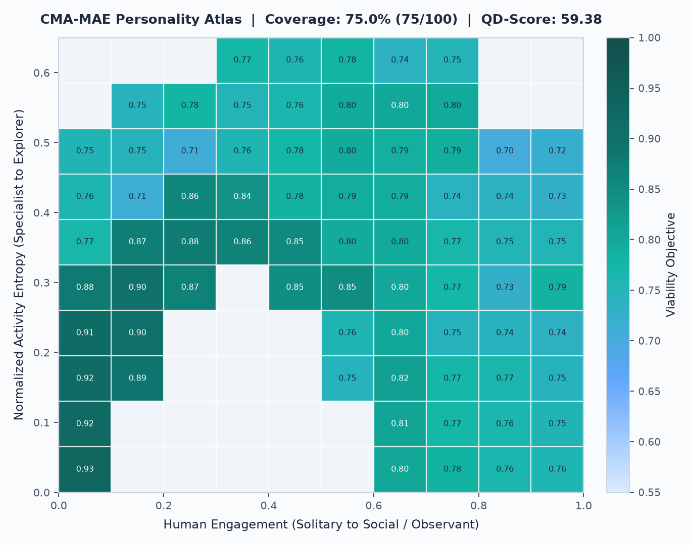
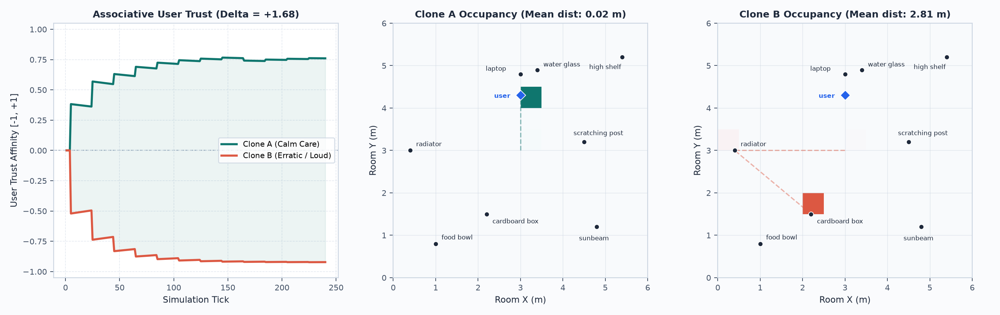
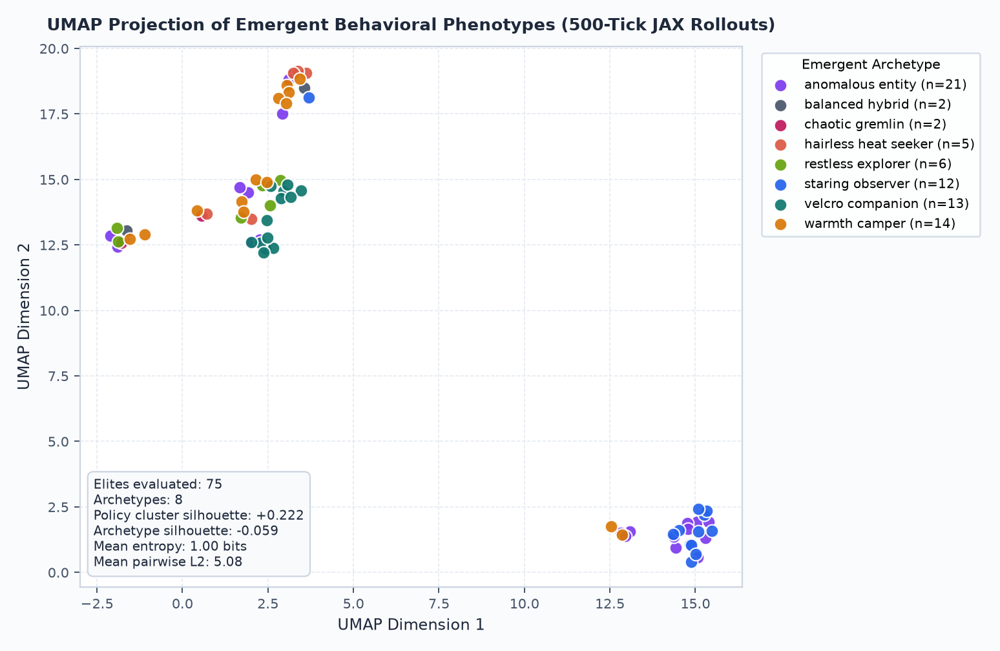
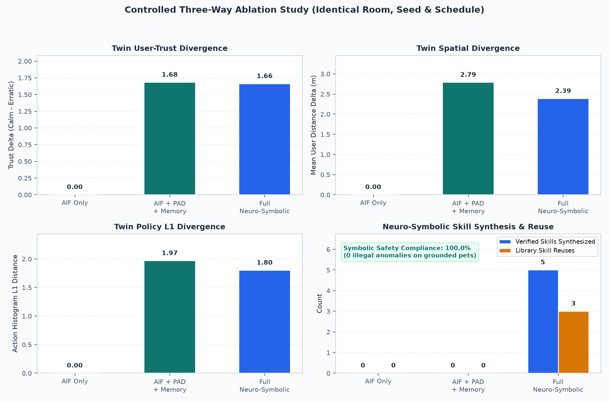

# PET-AI: Technical Architecture and Empirical Evaluation Notes

## 1. Motivation

Virtual pet simulations typically suffer from two structural failure modes. Hand-authored state machines and behavior trees encode personality through brittle `if/else` branches that repeat predictable loops. Pure end-to-end reinforcement learning policies often converge to a single reward-hacking optimum, collapsing personality diversity across runs and ignoring epistemic curiosity.

`pet-ai` addresses both limitations through a four-pillar Synthetic Ethology architecture. Personality is never scripted. Distinct behavioral phenotypes emerge from the interaction of:

1. A continuous 18-dimensional genetic specification coupled directly to room thermodynamics and locomotion physics.
2. A discrete factorized POMDP solved via Active Inference, where policies minimize Expected Free Energy across pragmatic and epistemic objectives.
3. Offline Quality-Diversity illumination over the genetic space via vectorized JAX rollouts and CMA-MAE.
4. Online emotional and episodic prior adaptation paired with an asynchronous, symbolically verified neuro-symbolic skill synthesizer.

## 2. Continuous 18D Trait Genome and Homeostatic Coupling

Every creature is parameterized by an 18-dimensional vector $\theta \in [0, 1]^{18}$ defined in `sim_core/genome.py`:

- **Temperament axes (9D):** `neuroticism`, `extraversion`, `dominance`, `impulsiveness`, `agreeableness`, `curiosity`, `laziness`, `attachment`, `chaos`.
- **Physical axes (5D):** `fur_density`, `body_mass`, `agility`, `metabolism`, `vocal_pitch`.
- **Anomaly axes (4D):** `gravity_defiance`, `spatial_phase`, `mimicry_drive`, `sentience_glimmer`. Grounded creatures keep these near `0.0`; values $\ge 0.80$ unlock corresponding surreal primitives inside the symbolic verifier.

Physical traits govern the room simulation directly rather than serving as cosmetic labels. The environment is a continuous $6\,\text{m} \times 6\,\text{m}$ room (`sim_core/world.py`) containing nine Smart Objects (`radiator`, `laptop`, `sunbeam`, `water_glass`, `food_bowl`, `cardboard_box`, `high_shelf`, `scratching_post`, `user`). Each heat emitter contributes a quadratic radial thermal field around ambient room temperature $T_{\text{amb}}$:

$$T(x, y) = T_{\text{amb}} + \sum_{i} \max(0, T_i - T_{\text{amb}})\,\max\!\left(0, 1 - \frac{d_i(x, y)}{R_i}\right)^2$$

The `HomeostasisEngine` (`sim_core/homeostasis.py`) couples `fur_density` $f$ to thermal conductance:

$$k(f) = 1.0 - 0.62\,f$$

A hairless creature ($f = 0.0$) has conductance $1.00$, while a dense-coated creature ($f = 0.9$) has conductance $0.442$, yielding a $2.26\times$ passive heat loss ratio below the $32.0\,^\circ\text{C}$ feline thermoneutral point. Below thermoneutrality, warmth reserve $w \in [0, 1]$ decays at:

$$\Delta w = -\max\!\left(0,\; 0.00045\,(32.0 - T_{\text{local}})\,k(f) - 0.00025\,\text{metabolism}\right)\,\Delta t$$

Core body temperature maps linearly to $T_{\text{core}} = 36.5 + 2.2\,w\,^\circ\text{C}$. Locomotion speed scales with agility as $v_{\max} = 0.45 + 0.55\,\text{agility}\,\text{m/tick}$, energy cost scales with `body_mass`, hunger rate scales with `metabolism`, and stimulation decay scales with `curiosity`.

## 3. Factorized Active Inference POMDP

Fast reactive cognition runs on CPU through JAX-backed `pymdp 1.0` (`sim_core/genome_mapper.py`, `sim_core/aif_agent.py`). The generative model factorizes hidden states into two factors and six observation modalities with sparse dependencies:

- **Hidden state factor 0 (`activity_state`, 8 controllable states):** `idle`, `radiator`, `laptop`, `food_bowl`, `cardboard_box`, `stare_user`, `rub_user`, `chaos_play`.
- **Hidden state factor 1 (`user_intent`, 2 uncontrollable states):** `calm`, `busy`. Transition matrix $B^{(1)}$ applies symmetric drift $0.82 / 0.18$ per tick so uncertainty about human intent continuously regenerates.
- **Observation modalities (6):** `thermal` (3), `satiety` (2), `effort` (3), `stimulation` (3), `social_contact` (3), `user_cue` (3). Dependency structure is `A_DEPENDENCIES = [[0], [0], [0], [0], [0, 1], [0, 1]]`.

### Epistemic Value Without Hardcoded Rules

Modality 5 (`user_cue`) has a strictly flat preference prior $C^{(5)} = [1, 1, 1]$, contributing zero pragmatic reward. Its likelihood sharpness depends on `curiosity` and `sentience_glimmer`:

$$\text{acuity} = 0.56 + 0.38\,(0.7\,\text{curiosity} + 0.3\,\text{sentience\_glimmer})$$

Under Expected Free Energy minimization, the agent evaluates each policy $\pi$ by combining pragmatic utility and epistemic information gain:

$$-G(\pi) = \sum_{m} \mathbb{E}_{q(o_m \mid \pi)}[\ln p(o_m \mid C)] + \sum_{m} \mathbb{E}_{q(o_m \mid \pi)}\!\left[D_{\text{KL}}\!\left(q(s \mid o_m, \pi)\,\|\,q(s \mid \pi)\right)\right]$$

Because `stare_user` maximizes mutual information between `user_cue` and the drifting hidden state `user_intent`, high-curiosity low-energy agents spontaneously perch and stare at the human purely to resolve epistemic uncertainty.

### Allostatic Preferences and Precision

At every tick, `build_C_preferences` shifts observation log-preferences $C$ continuously as a function of both genome traits and live homeostatic deficits (`cold_urgency`, `hunger_urgency`, `fatigue_urgency`, `boredom_urgency`). Policy precision $\gamma = 2.2 + 7.8\,(1 - \text{impulsiveness})$ and action sampling precision $\alpha = 2.5 + 9.5\,(1 - \text{impulsiveness})$ control exploration randomness without discrete branching.

## 4. Offline Quality-Diversity Illumination

Hand-tuning 18 continuous traits cannot reliably uncover the boundary behaviors of a non-linear POMDP. `qd_lab/jax_rollout.py` re-implements the simulation and `pymdp` inference cycle inside `jax.lax.scan` and vectorizes batches across genomes with `jax.vmap` compiled under XLA.

`qd_lab/qd_search.py` runs CMA-MAE through `pyribs` using a `10 x 10` `GridArchive` over two behavioral descriptors computed from each rollout (`qd_lab/behavior_descriptors.py`):

1. **Human Engagement** $\in [0, 1]$: weighted blend of social/observational policy ratios (`stare_user`, `rub_user`, `laptop`) and physical proximity ratio within $1.25\,\text{m}$ of the human.
2. **Normalized Activity Entropy** $\in [0, 0.65]$: Shannon entropy of the 8-action distribution divided by $\log_2(8) = 3.0$ bits.

The scalar viability objective combines homeostatic health ($55\%$), generative coherence via VFE decay ($30\%$), and non-idle agency ($15\%$). Across `2,304` genome evaluations completed in `14.86 s`, CMA-MAE illuminated `75 / 100` archive cells (`75.0%` coverage, `QD-score = 59.38`).

## 5. Continuous PAD Emotions and Episodic Prior Adaptation

Fast Active Inference alone has no cross-episode associative memory. `memory/emotion.py` tracks continuous Pleasure-Arousal-Dominance coordinates in $[-1, 1]^3$. Temperament determines the emotional baseline and decay rate $\lambda = 0.055 - 0.032\,\text{neuroticism}$, so high-neuroticism pets recover more slowly from startling events. Variational Free Energy prediction-error surprises (`vfe - vfe_ema`) perturb arousal and valence every tick.

`memory/memory_store.py` persists salient events in SQLite indexed by `sqlite-vec` cosine KNN over 384-dimensional embeddings (`FastEmbedder` ONNX `all-MiniLM-L6-v2` or deterministic `HashEmbedder`). For each entity, `entity_affinity` aggregates recency-weighted and importance-weighted trust $T \in [-1, 1]$ and fear $F \in [0, 1]$:

$$w_i = \text{importance}_i \cdot \exp\!\left(-0.004\,(t - t_i)\right)$$

`memory/prior_adaptation.py` maps current PAD state, `user_trust`, `user_fear`, `kitchen_fear`, and top-$k$ retrieved episodes into additive log-preference offsets $\Delta C$ applied directly to the Active Inference agent's `C` matrices before policy inference. Repeated gentle care raises `c_social[intimate]`, drawing the creature toward the user. Repeated shouts or loud clatter raise `c_social[solitary]` and `c_effort[restful]`, shifting the creature into avoidance and box-hiding without altering any control code.

## 6. Neuro-Symbolic Skill Synthesis and Verification

When sustained Free Energy exceeds `vfe_trigger_threshold = 3.2` for 8 ticks (subject to a 45-tick automatic synthesis cooldown) or when a user sends a freeform prompt, `NeuroSymbolicPetAgent` (`neuro_symbolic/orchestrator.py`) invokes a slow-system prefrontal loop:

1. **Semantic Recall:** Query `SkillLibrary` (`sqlite-vec`) for a previously verified `BehaviorSkill` matching the current trigger context and not on cooldown.
2. **Asynchronous Synthesis:** On a cache miss, dispatch `SkillSynthesizer.request_async` (`neuro_symbolic/llm_director.py`) on a dedicated worker thread with an immutable `WorldSnapshot` so the 6 Hz Active Inference loop never blocks or races against mutable world state. Local Ollama runs with `num_ctx=2048` and `/no_think` structured JSON schema constraints.
3. **Symbolic Verification and Repair:** Every candidate `BehaviorSkill` (2 to 6 steps, total duration $\le 36$ ticks, cooldown $\ge 10$ ticks) must pass `SymbolicSkillVerifier` (`neuro_symbolic/verifier.py`). The verifier enforces target existence, intactness for `nudge`, agility $\ge 0.65$ or active `invert_gravity` for elevated perches, non-empty text for `mimic_text`, and strict genome thresholds ($\ge 0.80$) for all four anomaly primitives (`invert_gravity`, `phase_object`, `mimic_text`, `telepathic_gaze`). Rejected drafts feed exact symbolic errors back into bounded repair retries. Verified skills are stored in `SkillLibrary` for zero-LLM reuse.

## 7. Empirical Evaluation and Ablation Results

All metrics below are measured directly by `scripts/run_sprint7_benchmarks.py` and saved in `benchmarks/results/benchmark_summary.json` and `benchmarks/results/elite_metrics.csv`.

### Archive-Wide Behavioral Evaluation (500-Tick JAX Rollouts)

All 75 elites from `data/archives/personality_archive.json` were re-evaluated for 500 ticks each (`37,500` total simulation ticks) to extract 16D behavioral feature vectors (8D action ratios, user proximity, disruption rate, warmth, hunger, energy, comfort, VFE, and action entropy).

| Metric | Measured Value |
| :--- | :--- |
| Archive Coverage | `75.0%` (`75 / 100` cells) |
| CMA-MAE QD-Score | `59.38` |
| Distinct Post-Hoc Archetypes | `8` |
| Shannon Action Entropy (bits) | `0.9972 +/- 0.4940` (range `[0.2043, 2.0928]`) |
| Mean Pairwise L2 Distance (16D Standardized) | `5.0816` |
| Mean Pairwise L2 Distance (8D Policy Simplex) | `0.8031` |
| Silhouette Score (4 Dominant Policy Clusters) | `+0.2217` |
| Silhouette Score (All 8 Post-Hoc Archetypes) | `-0.0594` |
| Mean Viability Objective | `0.7806` |
| Mean Variational Free Energy | `5.2629` |

The gap between dominant-policy silhouette (`+0.2217`) and full archetype silhouette (`-0.0594`) reflects the intended separation of layers. The `anomalous_entity` label (`n = 21`) marks genomes with `max_anomaly >= 0.80`. Because anomaly primitives activate only inside the Neuro-Symbolic Director and do not modify fast-path Active Inference likelihoods, anomalous genomes span across multiple grounded behavioral clusters (`radiator`, `stare_user`, `rub_user`, `laptop`) in UMAP space while retaining distinct high-level surreal capabilities at runtime.

### Controlled Three-Way Ablation Study

Three configurations were compared on identical rooms, seed (`42`), twin genome, and 240-tick calm vs. erratic sensory schedules, plus a 160-tick dual neuro-symbolic cue evaluation comparing an `impossible_cat` against a grounded `hairless_sphynx`.

| Configuration | Twin Trust Delta | Twin Spatial Delta (m) | Policy L1 Divergence | Verified Skills / Reuses | Grounded Safety Rate | Mean VFE | Mean Viability |
| :--- | :---: | :---: | :---: | :---: | :---: | :---: | :---: |
| **AIF Only** | `0.000` | `0.000` | `0.000` | `0 / 0` | `100.0%` | `7.664` | `0.738` |
| **AIF + PAD + Memory** | `+1.682` | `+2.790` | `1.967` | `0 / 0` | `100.0%` | `5.031` | `0.788` |
| **Full Neuro-Symbolic** | `+1.661` | `+2.386` | `1.800` | `5 / 3` | `100.0%` | `4.857` | `0.784` |

Key findings from the controlled ablation:

- **Necessity of Episodic Prior Adaptation:** Pure Active Inference (`AIF Only`) shows zero divergence between twins (`0.000` trust delta, `0.000 m` spatial delta, `0.000` policy L1) even when identical acoustic noise spikes hit the erratic room, because transient noise alone does not build persistent entity-level avoidance. Adding PAD emotions and `sqlite-vec` prior adaptation produces a `+1.682` trust gap (`+0.760` calm vs. `-0.922` erratic), a `+2.790 m` spatial separation (`0.024 m` vs. `2.814 m` mean distance from the user), and a `34.4%` reduction in mean VFE (`7.664` to `5.031`) alongside higher physiological viability (`0.738` to `0.788`).
- **Neuro-Symbolic Synthesis and Safety Gating:** The full stack preserves twin divergence (`+1.661` trust delta, `+2.386 m` spatial delta) while synthesizing `5` verified rituals on the `impossible_cat` with `3` library reuses (`120` anomaly-active ticks) and `7` grounded rituals (`2` reuses) on the `hairless_sphynx`. Across all `640` grounded ticks evaluated, `SymbolicSkillVerifier` enforced `0` illegal anomaly activations (`100.0%` symbolic safety compliance).

## 8. Compute and VRAM Budget on Consumer Hardware

The full architecture targets a single laptop equipped with an Intel Core 5 210H CPU and an NVIDIA RTX 3050 GPU with 6 GB VRAM:

- **Active Inference (`pymdp` / JAX):** Runs on CPU to reserve VRAM for rendering and local LLM inference. Real-time single-agent stepping stays well inside the 6 Hz (`166 ms`) tick budget.
- **Episodic Memory (`sqlite-vec` + ONNX):** Runs on CPU with sub-3 ms vector KNN retrieval latency.
- **Local LLM Director (Ollama `qwen3:1.7b`):** Context window capped at `num_ctx=2048` (~1.8 to 2.2 GB VRAM), invoked off-thread only on prompts or sustained VFE spikes with a 45-tick cooldown, and replaceable by `DeterministicMockAdapter` for zero-VRAM operation.
- **3D Studio Renderer (Godot 4.7.1 `gl_compatibility`):** Pure procedural primitive meshes with zero external asset packs (~0.5 to 0.9 GB VRAM), decoupled over WebSocket so Python cognition and 60 FPS Godot rendering run independently.

## 9. References

1. Friston, K., FitzGerald, T., Rigoli, F., Schwartenbeck, P., & Pezzulo, G. (2017). Active Inference: A Process Theory. *Neural Computation*, 29(1), 1-49.
2. Heins, C., Millidge, B., Demekas, D., Klein, B., Friston, K., Couzin, I. D., & Tschantz, A. (2022). pymdp: A Python library for active inference in discrete state spaces. *Journal of Open Source Software*, 7(73), 4098.
3. Fontaine, M. C., & Nikolaidis, S. (2023). Covariance Matrix Adaptation MAP-Annealing (CMA-MAE). *Proceedings of the Genetic and Evolutionary Computation Conference (GECCO)*.
4. Tjanaka, B., Fontaine, M. C., Lee, D. H., Zhang, Y., Balam, N. R., Dennler, N., Garlanka, S. S., Klapsis, N. D., & Nikolaidis, S. (2023). pyribs: A Bare-Bones Python Library for Quality Diversity Optimization. *GECCO*.
5. Wang, G., Xie, Y., Jiang, Y., Mandlekar, A., Xiao, C., Zhu, Y., Fan, L., & Anandkumar, A. (2023). Voyager: An Open-Ended Embodied Agent with Large Language Models. *arXiv:2305.16291*.
6. Mehrabian, A. (1996). Pleasure-Arousal-Dominance: A General Framework for Describing and Measuring Individual Differences in Temperament. *Current Psychology*, 14(4), 261-292.
