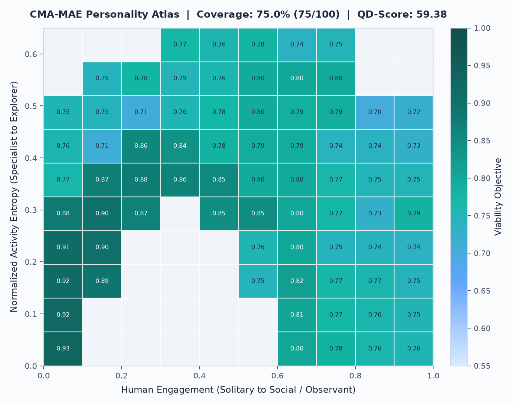
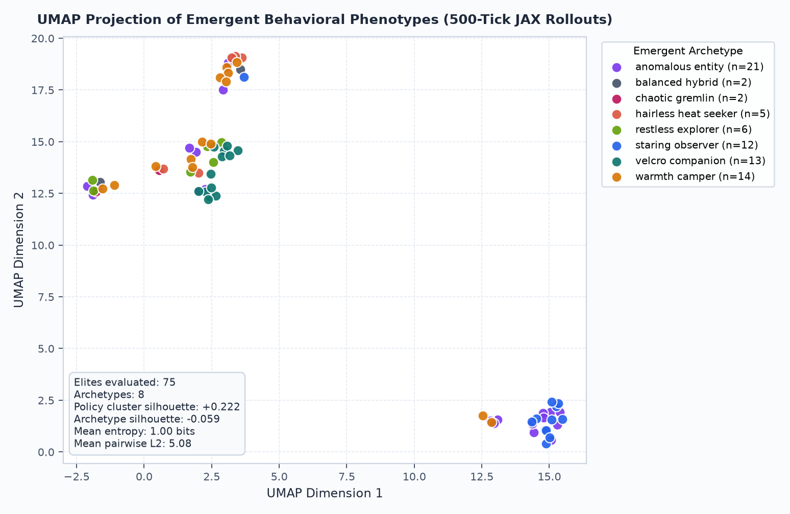
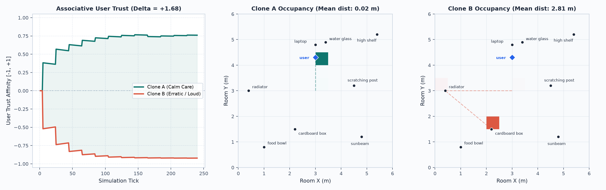
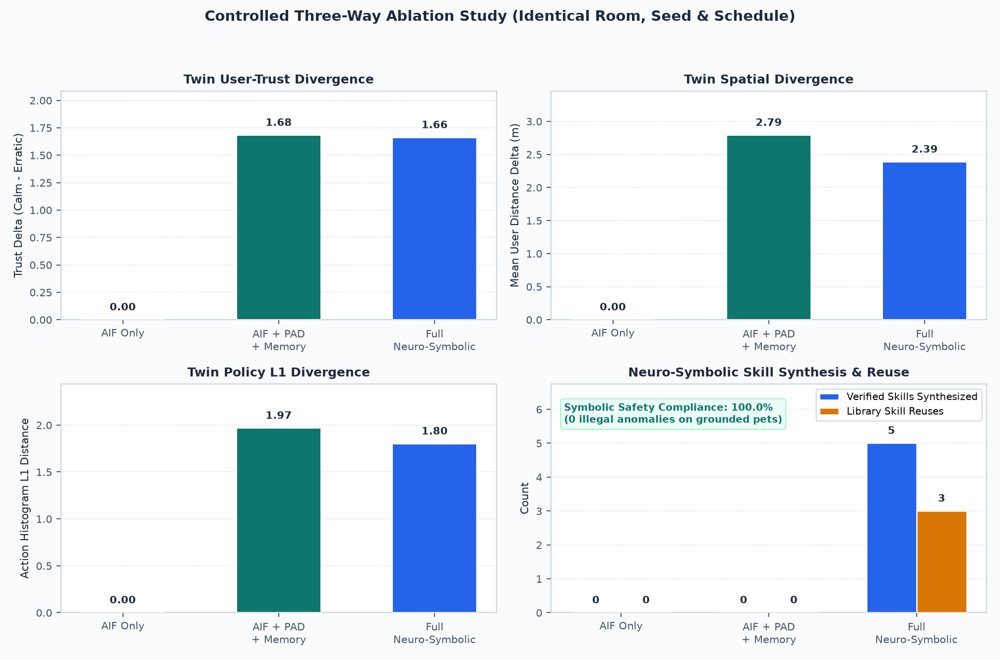

# PET-AI: Emergent Synthetic Ethology Lab

`pet-ai` is a Synthetic Ethology research sandbox where distinct feline personalities emerge from continuous biology, Active Inference, Quality-Diversity evolution, associative episodic memory, and symbolically verified neuro-symbolic skills. There are zero hardcoded personality `if/else` trees.

A hairless Sphynx camps near the wall radiator because low fur density doubles passive thermal loss in the room simulation. A high-curiosity observer perches and stares at the human to reduce Bayesian uncertainty over a drifting hidden user-intent state. Identical genetic twins raised under calm vs. loud treatment diverge by over 2.7 meters in spatial proximity through continuous PAD emotions and `sqlite-vec` prior adaptation. High-anomaly genomes synthesize verified surreal rituals such as ceiling gravity inversion while grounded genomes remain strictly bounded by symbolic safety rules.

---

## System Architecture

`pet-ai` decouples Python cognitive processing from real-time 3D visualization and browser telemetry through a multi-client FastAPI WebSocket bridge:

```text
+-----------------------------------------------------------------------------+
|                           PYTHON COGNITIVE BRAIN                            |
|                                                                             |
|  sim_core/                  memory/                     neuro_symbolic/     |
|  - 18D TraitGenome          - Continuous PAD Emotions   - BehaviorSkill DSL |
|  - 6m x 6m RoomWorld        - SQLite + sqlite-vec KNN   - Symbolic Verifier |
|  - HomeostasisEngine        - C-Prior Adaptation        - SkillLibrary      |
|  - pymdp 1.0 (JAX CPU)                                  - Async LLM Dir.    |
|                                                                             |
|  qd_lab/ (Offline Illumination)                                             |
|  - JAX vmap + lax.scan batched rollouts + pyribs CMA-MAE                    |
|  - Exports data/archives/personality_archive.json (75/100 elites)           |
+------------------------------------+----------------------------------------+
                                     |
                   bridge/ipc_server.py (FastAPI)
            Single Background Ticker + Broadcast Bus (6 Hz)
          ws://127.0.0.1:8765/ws  |  /health  |  /archive  |  /inspector
                         +-----------+-----------+
                         |                       |
                         v                       v
      +--------------------------------+   +--------------------------------+
      |    godot_client/ (Godot 4)     |   |  telemetry_ui/index.html       |
      |  - Procedural 3D Pet & Room    |   |  - Clickable 10x10 Atlas       |
      |  - Studio OrbitCamera Rig      |   |  - Live VFE & Policy q(pi)     |
      |  - Light-Mode TelemetryHUD     |   |  - 2D Interactive Room Minimap |
      |  - 60 FPS gl_compatibility     |   |  - Zero-Build Browser Client   |
      +--------------------------------+   +--------------------------------+
```

---

## Showcase Figures

### 1. CMA-MAE Personality Atlas & UMAP Phenotype Space

| CMA-MAE Illumination (`75.0%` Coverage) | 500-Tick UMAP Behavioral Clusters |
| :---: | :---: |
|  |  |

### 2. Twin Divergence & Three-Way Controlled Ablation

| Identical Twins: Calm vs. Erratic Care | Controlled Three-Way Ablation |
| :---: | :---: |
|  |  |

---

## Quantitative Benchmark Results

All numbers below are generated reproducibly by `scripts/run_sprint7_benchmarks.py` (`seed=42`) and exported to [benchmark_summary.json](benchmarks/results/benchmark_summary.json) and [elite_metrics.csv](benchmarks/results/elite_metrics.csv).

### Archive Illumination and Behavioral Diversity

| Benchmark Metric | Measured Value |
| :--- | :--- |
| CMA-MAE Archive Coverage (`10 x 10` grid) | `75.0%` (`75 / 100` elites) |
| CMA-MAE QD-Score | `59.38` (`2,304` evals in `14.86 s`) |
| Extended Rollout Evaluation | `75` elites x `500` ticks (`37,500` total ticks) |
| Distinct Emergent Archetypes | `8` |
| Shannon Action Entropy (bits) | `0.997 +/- 0.494` (range `0.204` to `2.093`) |
| Mean Pairwise L2 Distance (16D Behavioral / 8D Policy) | `5.082` / `0.803` |
| Dominant-Policy Cluster Silhouette Score | `+0.222` |
| Full Post-Hoc Archetype Silhouette Score | `-0.059` (latent anomaly trait spans grounded clusters) |

### Controlled Three-Way Ablation (240 Twin Ticks + 160 Neuro-Symbolic Cue Ticks)

| Configuration | Twin Trust Delta | Twin Spatial Delta (m) | Policy L1 Divergence | Verified Skills / Reuses | Grounded Safety | Mean VFE | Viability |
| :--- | :---: | :---: | :---: | :---: | :---: | :---: | :---: |
| **AIF Only** | `0.000` | `0.000` | `0.000` | `0 / 0` | `100.0%` | `7.664` | `0.738` |
| **AIF + PAD + Memory** | `+1.682` | `+2.790` | `1.967` | `0 / 0` | `100.0%` | `5.031` | `0.788` |
| **Full Neuro-Symbolic** | `+1.661` | `+2.386` | `1.800` | `5 / 3` | `100.0%` | `4.857` | `0.784` |

See [PAPER_NOTES.md](PAPER_NOTES.md) for the mathematical formulation, POMDP matrix definitions, and ablation analysis.

---

## Compute and VRAM Budget

Designed to run locally on a single laptop with an RTX 3050 (6 GB VRAM) and Intel Core 5 210H CPU:

| Subsystem | Device | Typical Memory / VRAM |
| :--- | :--- | :--- |
| Active Inference (`pymdp 1.0` / JAX) | CPU | ~0.4 GB RAM (0 VRAM) |
| Episodic Memory (`sqlite-vec` + ONNX `MiniLM`) | CPU | ~0.3 GB RAM (0 VRAM) |
| Local LLM Director (Ollama `qwen3:1.7b`, `num_ctx=2048`) | GPU (optional) | ~1.8 to 2.2 GB VRAM (0 VRAM with mock fallback) |
| Godot 4.7.1 Studio Client (`gl_compatibility`) | GPU | ~0.5 to 0.9 GB VRAM |
| **Total Live Footprint** | **Hybrid CPU + GPU** | **~2.5 to 3.1 GB VRAM (< 6 GB cap)** |

---

## Quickstart

### 1. Environment Setup (Python 3.12)

```powershell
python -m venv .venv
.\.venv\Scripts\python.exe -m pip install -e ".[dev,bench]"
```

### 2. One-Command Demo Launch (Godot 4 + Live Browser Inspector)

Start the FastAPI bridge, open the interactive MAP-Elites Browser Inspector at `http://127.0.0.1:8765/inspector`, and launch the Godot 4 3D Studio together:

```powershell
.\.venv\Scripts\python.exe scripts\launch_demo.py --preset impossible_cat --open-ui
```

Optional modes:

```powershell
# Live local Ollama synthesis (requires `ollama pull qwen3:1.7b`)
.\.venv\Scripts\python.exe scripts\launch_demo.py --preset impossible_cat --live-ollama --model qwen3:1.7b --open-ui

# Bridge + Browser Inspector only (no Godot window)
.\.venv\Scripts\python.exe scripts\launch_demo.py --preset staring_observer --no-godot --open-ui

# Explicit Godot 4 binary path
.\.venv\Scripts\python.exe scripts\launch_demo.py --godot-path "C:\path\to\Godot_v4.exe" --open-ui
```

### 3. Reproduce Benchmarks and Tests

```powershell
# Regenerate all 4 figures, CSV metrics, and benchmark_summary.json
.\.venv\Scripts\python.exe scripts\run_sprint7_benchmarks.py

# Run full unit and integration test suite
.\.venv\Scripts\python.exe -m pytest -v

# Run static lint checks
.\.venv\Scripts\ruff.exe check .
```

---

## Interactive Studio Controls and Hotkeys

| Input | Action |
| :--- | :--- |
| **Left-Click (Floor or Minimap)** | Move Human User to clicked room coordinate |
| **Hover Smart Object** | Highlight object and display temperature, elevation, and intact status |
| **Right-Click + Drag** | Orbit studio camera around focal point |
| **Mouse Wheel** | Smooth camera zoom in / out |
| **Middle-Click + Drag** or **W / A / S / D** / **Arrows** | Pan camera across the room |
| **`F`** | Toggle smooth Follow Cat mode (tracks perches and ceiling walks) |
| **`1`** / **`R`** | 3/4 Studio Overview camera preset |
| **`2`** | Close-Up Pet Cam preset (enables Follow Mode) |
| **`3`** | Top-Down Architectural CAD preset |
| **`Space`** | Pause / Resume simulation |
| **`Tab`** | Collapse / Expand right telemetry HUD panel |
| **`Esc`** | Unfocus prompt input box to restore hotkeys |

---

## Repository Structure

```text
pet-ai/
├── sim_core/          # 18D TraitGenome, RoomWorld, HomeostasisEngine, pymdp ActiveInferencePet
├── qd_lab/            # Vectorized JAX vmap/scan rollout engine & pyribs CMA-MAE search
├── memory/            # Continuous PAD EmotionEngine, sqlite-vec EpisodicMemoryStore, prior adaptation
├── neuro_symbolic/    # BehaviorSkill DSL, SymbolicSkillVerifier, SkillLibrary, async LLM Director
├── bridge/            # Multi-client FastAPI WebSocket + REST bridge (/ws, /health, /archive, /inspector)
├── godot_client/      # Godot 4 gl_compatibility procedural 3D studio, OrbitCamera, TelemetryHUD
├── telemetry_ui/      # Zero-build light-mode browser inspector with clickable 10x10 MAP-Elites atlas
├── benchmarks/        # Quantitative evaluation, UMAP clustering, 3-way ablation & exported results
├── docs/figures/      # Publication-ready light-mode CAD figures rendered in README and PAPER_NOTES
├── scripts/           # One-command launcher, bridge server, sprint demos, and benchmark CLI
├── tests/             # End-to-end automated pytest suite (Sprints 1 through 7)
├── PAPER_NOTES.md     # Technical monograph and mathematical formulation
└── README.md          # Project overview and quickstart guide
```
